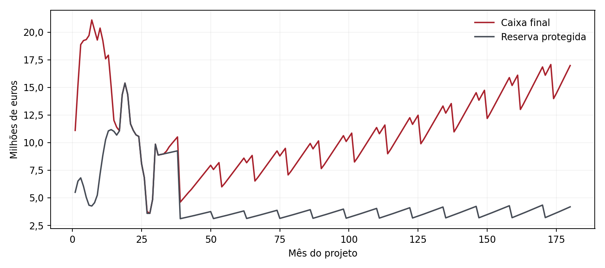

# KK-01 V05 Executive — Relatório executivo

21/10/2026. Estudo com Hotel Favorável, banco Limite aceitável6%, capital previsto25 M€, IVA integral com recuperação de estudo6 meses, regime fiscal geral e saída12×. Hipóteses não constituem compromissos ou benefícios concedidos.

## Conclusão financeira

O cenário de referência financia os 180 meses e conserva as reservas testadas, com défice de caixa e de reservas igual a zero. Depende da entrada integral e atempada do capital, das vendas previstas, da disponibilidade do banco e da recuperação do IVA. A folga mínima adicional à reserva é nula no M30; a cobertura base exige disciplina de execução.

A rentabilidade dos novos investidores é 7,65% de TIR e 2,67× de MOIC. O VPL a 12% é -9.671.683,48 €. O retorno fica abaixo do custo de capital próprio de estudo12%; o modelo não demonstra atratividade a essa taxa exigida. Os cenários de stress devem ser avaliados antes de concluir bancabilidade.

O projeto futuro, em base incremental sem repetir o histórico, apresenta TIR com saída de 19,18% e VPL a 10% de 22.265.284,54 €. São métricas dos fluxos do projeto, distintas da remuneração atribuída aos novos acionistas. Os retornos acionistas são anteriores à fiscalidade individual de cada investidor, ainda não documentada.

| Indicador | Referência V05 |
|---|---|
| VGV | 50.656.336,37 € |
| CAPEX futuro base | 63.168.000,00 € |
| IVA suportado | 8.629.200,00 € |
| Pico crédito IVA | 3.077.345,30 € |
| Pico da dívida | 18.245.949,67 € |
| Utilização acumulada | 22.413.853,79 € |
| Juros bancários | 860.053,89 € |
| Caixa M30 | 9.860.218,98 € |
| Caixa M42 | 5.493.562,96 € |
| Caixa M54 após distribuição | 5.995.124,82 € |
| Dividendo simulado M54 | 2.507.809,30 € |
| EBITDA Ano15 | 7.479.290,84 € |
| EV a 12× | 89.751.490,02 € |
| Equity Value saída | 102.644.161,83 € |
| Dividendos novos investidores | 15.327.298,18 € |
| VPL novos investidores a 12% | -9.671.683,48 € |

## Construção, fiscalidade e liquidez

O orçamento base 63,168 M€ contém 56,4 M€ de construção e FF&E inicial,1,128 M€ de fiscalização e5,64 M€ de contingência. Histórico4,5 M€ permanece fora das saídas futuras. O IVA de 8,6292 M€ é recuperável por hipótese, com financiamento temporário; não é duplicado no custo económico. A exposição de crédito IVA máxima é 3.077.345,30 €.

A reserva no último mês de crédito protege também o imposto reconhecido nas escrituras finais. Sem essa proteção, o cenário comparativo apresenta insuficiência máxima de reserva de 1.394.756,97 €. Com a proteção, o saldo de caixa M30 de 9.860.218,98 € acompanha dívida de 2.434.951,38 €. O aumento de caixa resulta do financiamento das obrigações previstas. A dívida é liquidada por cash sweep no M34, antes da carência contratualM42.

Os seguros de obra adicionais são197.400€ para30 meses. O seguro anual incremental do primeiro ano completo de operação é 208.330,48 €, calculado por bases e taxas sobre a receita V04, com entradas próprias para inclusão na empreitada ou no OPEX. Não foi imposto o total preliminar209.700€.

## Distribuições e valorização

O M54 suporta distribuição parcial de 2.507.809,30 €, abaixo do mínimo global 3 M€ em 492.190,70 €, com cobertura1,20× pelos 12 meses anteriores. Após distribuição, caixa 5.995.124,82 € e reserva 3.301.240,27 €. A análise independente de acumulados/Máximo suporta 4.150.000,00 € no M54 e deve ser distinguida do teste prudencial12M. Nenhum destes montantes é dividendo legalmente aprovado nem pagamento efetivo.

O EBITDA Ano15 é 7.479.290,84 €; o EV não inclui apartamentos vendidos. A saída deduz dívida, custos de 2%, contingências protegidas e IRPC por pagar (1.295.362,43 €), somando a caixa uma única vez. É avaliação estimada, sem comprador ou preço contratado.

Os novos investidores recebem 15.327.298,18 € de dividendos ordinários em 15 anos: 0,61× do capital aplicado. A recuperação integral do investimento depende da saída simuladaM180. O payback futuro do projeto sem saída, definido pelo último saldo acumulado negativo, é 106 meses; não é o payback acionista.

| Exit | TIR novos | MOIC novos | VPL a 12% |
|---|---|---|---|
| Prudente10× | 6,78% | 2,37× | -11.010.793,18 € |
| Base 12× | 7,65% | 2,67× | -9.671.683,48 € |
| Favorável15× | 8,79% | 3,11× | -7.663.018,92 € |

Comparativo de liquidação alternativa: a saídaM120 usa o EBITDA dos meses109–120 e também deduz o IRPC pendente no respetivo marco. É uma alternativa de estudo à saídaM180, não duas vendas acumuláveis.

| Horizonte / múltiplo12× | TIR novos | MOIC novos | Equity Value |
|---|---|---|---|
| 10 anos — saída alternativaM120 | 7,56% | 1,97× | 82.663.258,99 € |
| 15 anos — saída-baseM180 | 7,65% | 2,67× | 102.644.161,83 € |

## Acionistas e blocos

Mantêm-se15 blocos: JSCV2Platinum40%, JALS5Silver10%, novos1Platinum+2Gold+5Silver50%. Os tickets dos promotores são bases convencionais, sem entrada fictícia de 30 M€. Venda secundária é separada do dinheiro que entra na KK. Os oito calendários são planos de estudo, não compromissos.

| Bloco novo | Capital de cenário | TIR mensal anualizada | MOIC |
|---|---|---|---|
| P01 | 10.000.000,00 € | 8,23% | 2,82× |
| G01 | 5.000.000,00 € | 7,35% | 2,60× |
| G02 | 5.000.000,00 € | 7,39% | 2,60× |
| S01 | 1.000.000,00 € | 6,96% | 2,49× |
| S02 | 1.000.000,00 € | 7,01% | 2,49× |
| S03 | 1.000.000,00 € | 7,01% | 2,49× |
| S04 | 1.000.000,00 € | 7,06% | 2,49× |
| S05 | 1.000.000,00 € | 7,06% | 2,49× |

Os promotores, em conjunto, recebem 17.595.483,63 € de dividendos de cenário e 51.322.080,92 € na saída. A proxy de grupo baseada exclusivamente em 4,5 M€ no M0 produziria TIR 24,52% e MOIC 15,32×; esta é uma convenção comparativa, não o retorno histórico efetivo. Faltam custos e datas individuais de JSCV/JALS para determinar TIR histórica por promotor.

## Condições para o sucesso

Confirmar capital e datas dos oito blocos, contratos de venda, orçamento de execução, disponibilidade bancária e requisitos de draw. Validar bases fiscais, prazos de IVA e de IRPC e encargos já incluídos na obra/OPEX. Formalizar direitos societários, reservas e deliberações antes de distribuir. A Convenção permanece em preparação e sem benefícios aprovados ativos.

O stress combinado — atraso de capital e vendas6 meses, IVA diferido18 meses, seguros+50%, sobrecusto10% e juros8% — apresenta défice máximo de financiamento 12.294.378,69 € e insuficiência de reserva 17.923.380,07 €. Retornos desse cenário são condicionais à resolução dos défices.

Excel Desktop indisponível: a compatibilidade não está certificada nesse motor. A conformidade de cálculo foi verificada em Python e LibreOffice; fiscalidade, contratos, incentivos e pagamentos requerem validação externa.
